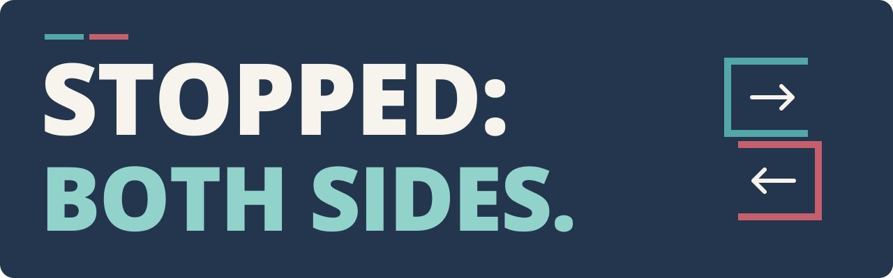
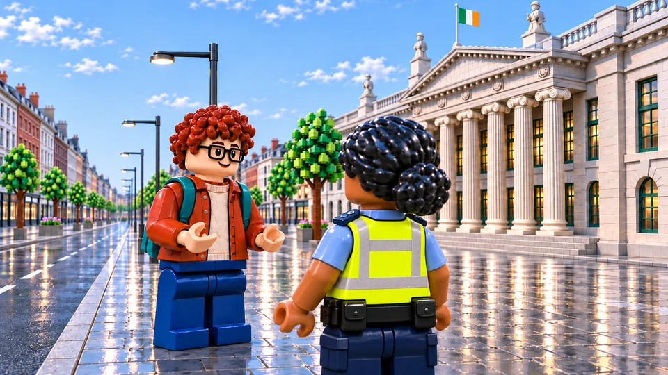
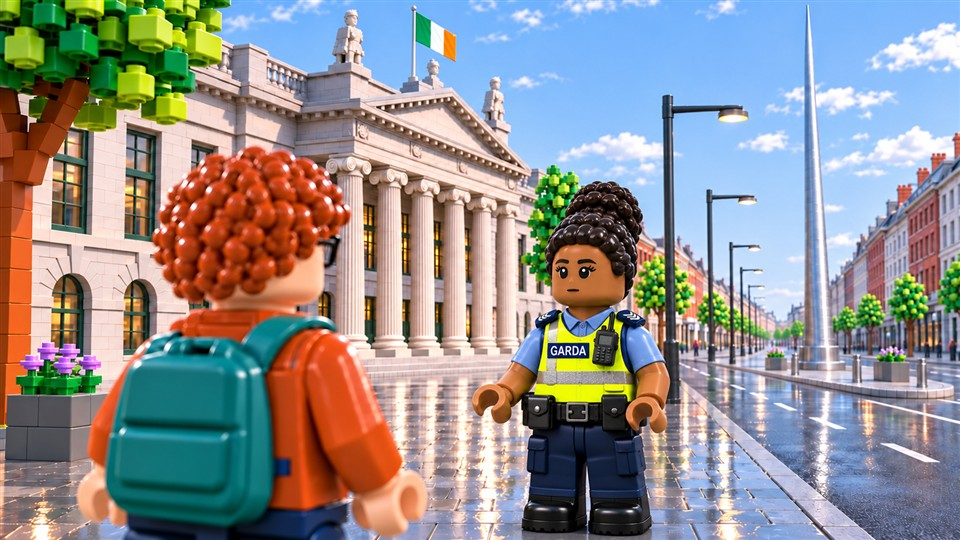

<a name="top"></a>

<h1 align="center">
  
</h1>

<p align="center">
  <strong>One situation. Two perspectives.</strong><br>
  Explore the same fictional encounter as a member of the public and as a Garda.<br>
  Make a choice, follow the reasoning and see what changes from the other side.
</p>

<p align="center">
  <a href="https://samobrienolinger.github.io/stopped-both-sides/"></a>
  <a href="https://samobrienolinger.github.io/stopped-both-sides/garda/"></a>
</p>

<p align="center">
  <a href="https://samobrienolinger.github.io/stopped-both-sides/"><strong>Explore the public perspective →</strong></a>
  &nbsp; · &nbsp;
  <a href="https://samobrienolinger.github.io/stopped-both-sides/garda/"><strong>Explore the Garda perspective →</strong></a>
</p>

<p align="center">
  <strong>34</strong> shared situations &nbsp; · &nbsp;
  <strong>99</strong> decision stages &nbsp; · &nbsp;
  <strong>19</strong> characters &nbsp; · &nbsp;
  <strong>9</strong> languages
</p>

<p align="center">
  <a href="#the-experience">The experience</a> ·
  <a href="#run-locally">Run locally</a> ·
  <a href="#documentation">Documentation</a> ·
  <a href="#evidence-and-boundaries">Evidence &amp; boundaries</a>
</p>

<!-- Legacy README section links lead to the relevant overview and handbook links. -->
<a name="purpose-and-audience"></a>
<a name="how-it-works"></a>
<a name="what-you-can-explore"></a>
<a name="step-by-step-walkthrough"></a>
<a name="finding-situations-and-sources"></a>
<a name="characters-and-switching-sides"></a>
<a name="scores-and-progress"></a>
<a name="user-flow-infographic"></a>

## The experience

**What would you do? What might the other person understand differently?**

Stopped: Both Sides is an interactive learning resource about human and civil rights, responsibilities and Garda decision-making in the **Republic of Ireland**. It supports individual exploration and facilitated discussion through branching, fictional situations.

1. **Choose a perspective.** Pick a character and a situation, from street questions and searches to fair treatment and discrimination.
2. **Make a decision.** Choose a response, then explore the explanation, feedback and supporting sources.
3. **Compare the other side.** Switch roles at the same moment. Both answers are kept; the active role’s choice determines the next branch.
4. **Reflect and replay.** Review the paired recap, reconsider an answer or return to a saved situation.

**Different perspectives carry different powers and responsibilities.** A member of the public is never scored as responsible for another person’s misconduct, and cooperation is not presented as a guarantee of safety.

[Full walkthrough →](docs/PROJECT-HANDBOOK.md#how-it-works) · [Illustrated user guide](docs/user-guide/README.md) · [Printable guide (PDF)](docs/user-guide/stopped-both-sides-user-flow.pdf?raw=true)

<a name="accessibility-and-language"></a>
<a name="privacy"></a>

## Built for people

- **Read your way.** Nine languages, including Gaeilge and right-to-left Arabic, with adjustable text size, contrast, spacing and motion.
- **Explore without an account.** Learning progress and preferences stay in the browser when storage is available. The application includes no analytics or advertising pixels.
- **Keep the reasoning visible.** Decisions connect to explanations, learning points and sources; separate scores support reflection on each role.

Progress is stored separately for the two site entry points. Transfer links can contain learning records, and hosting logs are separate from application storage. See [privacy and progress](docs/PROJECT-HANDBOOK.md#privacy) for the details.

[Accessibility and languages →](docs/ACCESSIBILITY-AND-LANGUAGES.md) · [Characters](docs/CHARACTERS.md) · [Perspectives and scores](docs/PERSPECTIVES-AND-SCORES.md)

<a name="getting-started"></a>
<a name="checks-and-review"></a>
<a name="architecture"></a>
<a name="repository-map"></a>
<a name="interface-and-language-implementation"></a>
<a name="entity-relationship-diagrams"></a>
<a name="encounters-and-perspectives"></a>
<a name="saved-learning-progress"></a>
<a name="deployment"></a>

## Run locally

**HTML, CSS and native JavaScript modules.** The site runs without a build step, backend or API keys.

With **Git and Node.js 20 or later**:

```sh
git clone https://github.com/SamOBrienOlinger/stopped-both-sides.git
cd stopped-both-sides
npm run dev
```

Open **[http://127.0.0.1:4173/](http://127.0.0.1:4173/)** for the public entry point or **[http://127.0.0.1:4173/garda/](http://127.0.0.1:4173/garda/)** for the Garda entry point. No dependency installation is needed for the local server or core checks.

```sh
npm run check  # Validate JavaScript syntax
npm test       # Run the core regression checks
```

Browser checks use Playwright and require additional setup. The handbook covers [installation and checks](docs/PROJECT-HANDBOOK.md#checks-and-review), [shared architecture](docs/PROJECT-HANDBOOK.md#architecture) and [GitHub Pages deployment](docs/PROJECT-HANDBOOK.md#deployment).

[](https://github.com/SamOBrienOlinger/stopped-both-sides/actions/workflows/checks.yml)
[](https://github.com/SamOBrienOlinger/stopped-both-sides/actions/workflows/browsers.yml)

<a name="documentation-and-repository-guide"></a>

## Documentation

**[Open the project handbook →](docs/PROJECT-HANDBOOK.md)**

The complete guide brings together usage, architecture, deployment, privacy, educational methodology, teaching activities and research references.

- **For learners and facilitators:** [walkthrough](docs/PROJECT-HANDBOOK.md#step-by-step-walkthrough), [teaching activities](docs/PROJECT-HANDBOOK.md#research-and-teaching-examples) and [intended learning outcomes](docs/PROJECT-HANDBOOK.md#intended-learning-outcomes).
- **For developers:** [repository map](docs/PROJECT-HANDBOOK.md#repository-map), [data diagrams](docs/PROJECT-HANDBOOK.md#entity-relationship-diagrams) and [browser compatibility](docs/BROWSER-COMPATIBILITY.md).
- **For reviewers:** [content review](docs/CONTENT-REVIEW.md), [research record](research/README.md) and [evaluation proposal](docs/PROJECT-HANDBOOK.md#evaluating-the-learning).

<a name="evidence-and-content-review"></a>
<a name="human-and-civil-rights-sources"></a>
<a name="distinctive-proposition-and-educational-contribution"></a>
<a name="a-potentially-useful-educational-combination"></a>
<a name="similar-product-plus"></a>
<a name="contribution-within-the-wider-learning-portfolio"></a>
<a name="educational-approach-methodology-and-learning-outcomes"></a>
<a name="learning-approach-at-a-glance"></a>
<a name="research-and-teaching-examples"></a>
<a name="a-practise-decisions-in-context"></a>
<a name="b-learn-through-explanations"></a>
<a name="c-compare-perspectives-while-recognising-uncertainty"></a>
<a name="d-turn-a-playthrough-into-reflective-learning"></a>
<a name="e-use-replay-to-support-recall-and-application"></a>
<a name="f-practise-fair-and-understandable-communication"></a>
<a name="educational-comparators"></a>
<a name="learning-methodology"></a>
<a name="intended-learning-outcomes"></a>
<a name="evaluating-the-learning"></a>
<a name="assess-understanding-transfer-and-retention"></a>
<a name="use-a-meaningful-comparison"></a>
<a name="consider-different-audiences"></a>
<a name="keep-outcome-levels-distinct"></a>
<a name="educational-rationale"></a>
<a name="pedagogical-references"></a>
<a name="pedagogy-reference-1"></a>
<a name="pedagogy-reference-2"></a>
<a name="pedagogy-reference-3"></a>
<a name="pedagogy-reference-4"></a>
<a name="pedagogy-reference-5"></a>
<a name="pedagogy-reference-6"></a>
<a name="pedagogy-reference-7"></a>
<a name="pedagogy-reference-8"></a>

## Evidence and boundaries

The resource connects scenarios to legal, professional, academic and community sources. Its [educational methodology and research references](docs/PROJECT-HANDBOOK.md#educational-approach-methodology-and-learning-outcomes) explain the rationale for decisions, feedback, replay and perspective-taking.

This is an **independent educational prototype**, providing general learning rather than legal advice or accredited Garda training. Northern Ireland has different laws. Scores are reflective feedback; learning effectiveness and competence assessment have not been validated.

WCAG 2.2 AA is an accessibility target, not a certification. Specialist legal review, language review, evaluation with disabled users and independent learning research remain opportunities for development. No endorsement by INAR, ICCL or An Garda Síochána is claimed.


## Contributing and support

**[Report a bug or suggest an improvement →](https://github.com/SamOBrienOlinger/stopped-both-sides/issues)**

For bugs, include the perspective, situation, steps and browser/device. For content corrections, identify the decision and a supporting source. Keep reports focused on the fictional exercise; real incident details are not needed.

[Contribution guide →](docs/PROJECT-HANDBOOK.md#contributing-and-support) · [Translation maintenance](docs/ACCESSIBILITY-AND-LANGUAGES.md#maintaining-translations)

<a name="credits-and-reuse"></a>
<a name="design-and-acknowledgements"></a>
<a name="copyright--reuse"></a>

---

Created by **Sam O’Brien-Olinger** / [Sam Tim Solutions](https://samobrienolinger.github.io/SamOBrienOlinger/).

**© 2026 Sam O’Brien-Olinger. All rights reserved for original project code and content.** Use the live website as intended; other reuse requires permission unless an applicable licence or law permits it. See the full [copyright and reuse terms](docs/PROJECT-HANDBOOK.md#copyright--reuse), including GitHub viewing and forking rights and third-party licences.

Illustrations were created with OpenAI image generation; the project is independent of LEGO. [Artwork, influences and acknowledgements →](docs/PROJECT-HANDBOOK.md#design-and-acknowledgements)

<p align="center">
  <a href="https://samobrienolinger.github.io/stopped-both-sides/">Explore the public perspective</a> ·
  <a href="https://samobrienolinger.github.io/stopped-both-sides/garda/">Explore the Garda perspective</a> ·
  <a href="#top">Back to top ↑</a>
</p>
