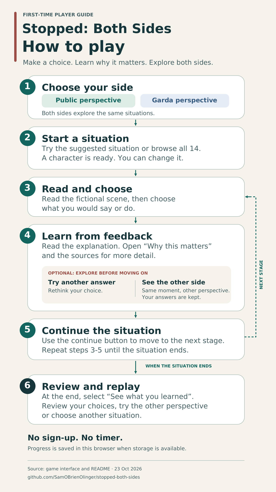
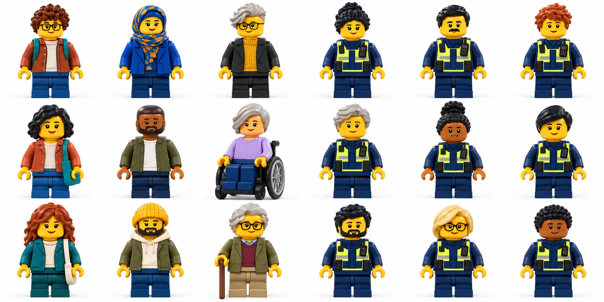

<p align="center">
  
</p>

<h1 align="center">Stopped: Both Sides</h1>

<p align="center">
  <strong>One encounter. Two perspectives. Learn why a choice matters.</strong><br>
  An interactive learning game about public rights and Garda decisions in the Republic of Ireland.
</p>

<p align="center">
  <a href="https://samobrienolinger.github.io/stopped-both-sides/"><strong>▶ Play as a member of the public</strong></a>
  &nbsp; · &nbsp;
  <a href="https://samobrienolinger.github.io/stopped-both-sides/garda/"><strong>▶ Play from the Garda perspective</strong></a>
</p>

<p align="center">
  <a href="https://samobrienolinger.github.io/stopped-both-sides/">
    
  </a>
  <a href="https://samobrienolinger.github.io/stopped-both-sides/garda/">
    
  </a>
</p>

<p align="center">
  <strong>14 shared situations</strong> &nbsp; · &nbsp; <strong>59 stages</strong> &nbsp; · &nbsp; <strong>18 characters</strong><br>
  Play in your browser · No sign-up · No timer
</p>

<p align="center">
  <a href="#how-to-play">Play guide</a> ·
  <a href="#user-flow-infographic">Visual guide</a> ·
  <a href="#characters-and-switching-sides">Characters</a> ·
  <a href="#accessibility-and-language">Language &amp; reading</a> ·
  <a href="#evidence-and-content-review">Evidence</a> ·
  <a href="#educational-approach-methodology-and-learning-outcomes">Learning approach</a> ·
  <a href="#getting-started">Developers</a> ·
  <a href="#contributing-and-support">Help &amp; contribute</a>
</p>

---

Explore a fictional encounter with An Garda Síochána, choose a response and read the explanation. Switch perspectives to consider the same moment from the other side, with both sets of answers kept for comparison.

> [!NOTE]
> **An independent educational prototype.** This game provides general learning about the **Republic of Ireland**, not legal advice or accredited Garda training. Northern Ireland has different laws. Specialist legal, community and language review remain opportunities for further development.

## How to play

**Read a situation → choose a response → learn why it matters.**

1. **Choose your perspective.** Open the [public game](https://samobrienolinger.github.io/stopped-both-sides/) or the [Garda game](https://samobrienolinger.github.io/stopped-both-sides/garda/).
2. **Start a situation.** Select **Start this situation** for the suggested street encounter, or **Browse all 14 situations**. A character is ready for you; **Choose a different character** is optional.
3. **Read and choose.** Consider the fictional scene, then choose what to say or do.
4. **Learn from the feedback.** Read the explanation, **Why this matters** and the linked sources.
5. **Continue the encounter.** Select **Next step** or **Explore the next variation** when offered, and repeat the read–choose–learn loop. Your active role's answer determines the next branch.
6. **Review and replay.** At the end, select **See what you learned** for the recap. Revisit a decision, explore the other perspective or try another situation.

> [!TIP]
> **You can pause and reconsider.** **Try another answer** replaces your answer for the active role. **See the other side** switches perspective at the same moment and keeps both roles' answers. You can reach the recap while playing one perspective; exploring both is optional.

Find detailed scores and supporting guidance under **Scores, sources and help**. All gameplay runs in your browser, with no AI service involved during play. Progress can be saved in this browser when storage is available; see [privacy and saving](#privacy).

### User-flow infographic

A visual version of the six steps above, including the optional retry and perspective-switching paths.

<p align="center">
  <a href="docs/user-guide/stopped-both-sides-user-flow.png?raw=true">
    
  </a>
</p>

<p align="center">
  <a href="docs/user-guide/stopped-both-sides-user-flow.png?raw=true"><strong>Open full-size PNG</strong></a> ·
  <a href="docs/user-guide/stopped-both-sides-user-flow.pdf?raw=true"><strong>Download printable PDF</strong></a>
</p>

## Purpose and audience

### What you can explore

Both perspectives belong to the same game. Choose either starting point and switch when you want to compare the reasoning.

| Start with the public perspective | Start with the Garda perspective |
| --- | --- |
| Explore rights, responsibilities and access to support. | Explore evidence, professional judgement and fair treatment. |
| Street questions, a bag search, arrest, the station, a young person and concerns about racism. | Suspicion, descriptions, search grounds, communication, assumptions about age, colleague pressure, new evidence and supervision. |
| **[Play the public perspective →](https://samobrienolinger.github.io/stopped-both-sides/)** | **[Play the Garda perspective →](https://samobrienolinger.github.io/stopped-both-sides/garda/)** |

Each shared situation offers branching choices, immediate explanations and links to supporting sources. Characters and answers stay with the encounter when you switch sides. Saved progress lets you revisit learning points and replay routes.

The guiding principles are clear information, evidence-based reasoning, dignity and reflection. **Perspective-taking does not imply equal legal powers or equal responsibility.** A member of the public is never scored as responsible for another person's misconduct, and cooperation is not presented as a guarantee of safety.

The original single-role practice also remains available: six public situations with 26 decision nodes, and eight Garda situations. A stage in original practice can transfer into its matching shared situation.

## Characters and switching sides

**18 fictional LEGO-style characters. Nine for each side.** You choose a character, not a personal identity profile. The cast includes men, women and characters with an ambiguous gender presentation.

<p align="center">
  
</p>

**[Choose a public character](https://samobrienolinger.github.io/stopped-both-sides/#encounters/public)** · **[Choose a Garda character](https://samobrienolinger.github.io/stopped-both-sides/garda/#encounters/garda)**

| When you… | The game… |
| --- | --- |
| **Start a shared situation** | Uses your selected character and randomly chooses the character opposite you. |
| **Switch perspective** | Puts you in the existing opposite character's place, keeping both roles' answers and scores. |
| **Change character** | Changes only your active character's name and picture. The stage, other character, answers and scores stay in place. Switch sides first to change the other character. |
| **Continue, resume or replay** | Keeps the same pair, including in feedback and the recap. Starting a new situation chooses a new random counterpart. |

**Your character** and **Other character** labels show who you are playing. You can change character during a scene, feedback or recap. Names update across supported languages; scenario ages, teaching facts, choices, legal responsibilities and scores remain fixed.

Saved encounters and transfer links retain the pair. Older saved formats remain readable. In original practice, **Change character** opens the matching shared stage and preserves the selected answer. The [character guide](docs/CHARACTERS.md) explains persistence, compatibility and artwork.

## Accessibility and language

**Make the game easier to read:** open **Language & reading** in the header or footer, adjust your preferences, then select **Apply preferences**.

| Setting | Available options |
| --- | --- |
| **Language** | English, Gaeilge, Portuguese, Arabic, Polish, Romanian, French, Spanish and Mandarin Chinese in Simplified script. |
| **Reading** | Larger text, high contrast, increased spacing and reduced motion. |
| **Navigation** | Keyboard controls, visible focus, status announcements and written role labels alongside perspective colours. |

Portuguese, Arabic, Polish, Romanian, French, Spanish and Simplified Chinese cover both game modes and the information pages. Arabic uses right-to-left text. **Gaeilge covers shared play; its reference pages remain labelled English.** Selecting Irish during original practice opens the matching shared situation.

Changing language keeps your stage, characters, answers, role and scores. Translations are learning aids awaiting independent language and legal review. The implementation targets **WCAG 2.2 AA**; automated checks are not an accessibility certification. Real-device, screen-reader and disabled-user testing remain necessary.

[Accessibility and language guide →](docs/ACCESSIBILITY-AND-LANGUAGES.md) · [Browser coverage and limits →](docs/BROWSER-COMPATIBILITY.md)

## Scores and progress

**Use scores to revisit the reasoning behind a choice.** Each perspective has its own score.

| Result | How it works |
| --- | --- |
| **Stage feedback** | 1 point for an appropriate response on the stated facts; 0 where the reasoning needs review. More than one response can earn a point. |
| **Current route** | A completed role result requires an answer in that role at every stage on the finished route. |
| **Saved learning progress** | Keeps the best point earned at each unique stage, up to 59 per role. Repeating a mastered stage does not add points. |
| **Replay** | Retains latest and best completed results. Revisiting a stage can improve learning progress. |

There are no point penalties for taking time, switching perspective or requesting help. Scores do not measure personal bias, reward avoiding arrest, certify professional competence or establish that the game changes behaviour.

The approach adapts running points, feedback and saved best results from **AllyIndex**. See [Perspectives and scores](docs/PERSPECTIVES-AND-SCORES.md) for the rubric, branching, storage and attribution.

## Privacy

**No accounts, analytics, tracking scripts or forms for real incidents.** Choices, scores, character selections, reading preferences and a resume point are saved in browser storage when it is available.

- **Saving is local.** Separate browsers and devices do not synchronise automatically. If saving is blocked, character selection and changes still work for the current visit.
- **Switching sites carries progress in the game link.** Each perspective keeps a separate record; the link carries and merges progress. Copying that link can share the learning record it contains.
- **Clearing progress has limits.** Clearing one perspective does not clear the other's record or previously copied links. Character preferences are stored separately and are kept when progress is cleared.

Hosting services may retain ordinary access logs. See [Persistence and transfer](docs/PERSPECTIVES-AND-SCORES.md#persistence-and-transfer) for storage limits and recovery behaviour.

---

## Evidence and content review

The learning points draw on Irish legal and rights information, community research and a selected critical review of academic literature on policing decisions and bias. **Each decision links to its supporting sources.**

The documented source review is dated **7 September 2026**. Older publications are dated and are not treated as current authority for every procedure. The research record distinguishes jurisdiction, access limitations and how findings inform the game; it does not claim an exhaustive review or proven training effectiveness.

**[Content review record](docs/CONTENT-REVIEW.md)** · **[Research approach](research/README.md)** · **[Bibliography](research/bibliography.md)** · **[Scenario evidence map](research/scenario-evidence-map.md)**

<details>
<summary><strong>Read the source overview, educational rationale and related projects</strong></summary>

### Public-rights sources

- [Citizens Information — Questioning and surveillance](https://www.citizensinformation.ie/en/justice/arrests/questioning-and-surveillance/).
- [INAR — policing resources](https://inar.ie/?s=Police) and the [INAR / ICCL community and rights report on policing and racial discrimination (PDF)](https://inar.ie/wp-content/uploads/2024/04/1.-POLICING-AND-RACIAL-DISCRIMINATION-1.pdf).
- [ICCL — Criminal Justice and Garda Powers guide, second edition (2014)](https://www.iccl.ie/resources/know-your-rights-criminal-justice-and-garda-powers-2nd-edition-june-2014/).
- [DPP — Letters of rights](https://www.dppireland.ie/criminal-justice-system/letters-of-rights/), the [Legal Aid Board — Garda Station Legal Advice Revised Scheme](https://www.legalaidboard.ie/about-the-legal-aid-board/criminal-legal-aid/the-garda-station-legal-advice-revised-scheme/) and [Fiosrú — FAQs](https://www.fiosru.ie/about-us/faqs/).

Revised legislation and Garda professional sources are recorded alongside the scenarios. Older publications are dated and are not treated as current authority for every procedure. The [content review record](docs/CONTENT-REVIEW.md) documents source access and editorial decisions; the [research approach](research/README.md), [bibliography](research/bibliography.md) and [scenario evidence map](research/scenario-evidence-map.md) explain the Garda learning foundations.

Further development offers opportunities for input from INAR, other community organisations, legal specialists, Garda educators, disabled users, translators and learning researchers. These are proposed contributions; no partnership or endorsement is claimed.

### Distinctive proposition and educational contribution

> **One encounter. Two perspectives. Explore public rights and Garda decision-making in the same fictional situation, then compare the reasoning with sources.**

The strongest proposition is the **combination of public-rights education and reflective Garda decision-making within the same branching encounter**. Learners can switch roles without losing the situation or either role's answers. This makes it possible to compare how the two sets of decisions relate to one another, rather than presenting the public and Garda perspectives as unrelated lessons.

#### A potentially useful educational combination

| What the game brings together | Potential educational contribution |
| --- | --- |
| A shared situation, persistent characters and retained answers for both roles | Let learners compare perspectives within the same encounter and revisit the reasoning behind each decision. |
| Public rights and responsibilities alongside Garda powers, evidence and professional judgement | Support discussion of how individual rights and the exercise of state authority interact in a specific Irish setting. |
| Branching choices, immediate explanations, source links and a paired recap | Turn each decision into an opportunity to examine assumptions, communication, bias and reasons to reconsider, rather than reducing it to a right-or-wrong score. |
| Browser-based play, replay and reading controls without an account requirement | Offer a low-barrier format for independent exploration and potential facilitated discussion without requiring reports of real incidents. |

**Its distinctiveness lies in the paired, Ireland-specific examination of an encounter.** The learner can ask both “What are this person's rights?” and “What evidence and responsibilities should guide this Garda's decision?” within one exercise. The potential contribution is a shared reference point for rights literacy, critical reflection and informed community dialogue.

Perspective-taking does **not** imply equal legal powers, equal responsibility for an encounter or that a member of the public is responsible for Garda misconduct. The learning model preserves those distinctions; it does not score compliance as a guarantee of safety or claim that the game measures personal bias.

#### Similar product: PLUS

[**PLUS — Police Training Using Simulations, Bournemouth University and Dorset Police, UK**](https://www.bournemouth.ac.uk/research/projects/plus-project-serious-games-police-training) is a documented research prototype using simulated stop-and-search encounters and role-playing for police training. Its published focus is preparing police officers and trainees for practice. It is a close methodological comparator, not a public app confirmed to be currently available.

Stopped: Both Sides' distinguishing proposition is **a public-facing Republic of Ireland learning experience in which the same learner can explore both sides of the same encounter, retain both sets of answers and compare sourced explanations**. The contribution lies in this combination of rights education, paired perspectives and reflective reasoning, not in the invention of police simulations or a claim of professional training equivalence.

#### Contribution within the wider learning portfolio

Alongside [A New Life in Ireland](https://samobrienolinger.github.io/My-New-Life-in-Ireland/), which explores migration and settlement, and [Saggart & Citywest Together](https://samobrienolinger.github.io/saggart-and-citywest-together/), which connects local knowledge and community supports, this game supplies the **encounter-based rights-and-responsibilities learning layer**. Together they offer a potentially useful combination of migration understanding, local belonging and rights literacy. They remain separate resources; this game addresses public/Garda encounters generally, not migrants as a policing category.

Specialist legal review, input from communities and Garda educators, accessibility testing and learner evaluation are opportunities to establish accuracy, relevance and educational benefit. Improved conduct, reduced bias or accredited training effectiveness are not claimed as measured outcomes. The comparator description was checked against its official project page on **14 September 2026**; no affiliation, endorsement or exhaustive claim of uniqueness is implied.

</details>

## Educational approach, methodology and learning outcomes

**Practise a decision. Examine the reasoning. Compare perspectives. Apply what you learn.**

Stopped: Both Sides uses **scenario-based learning** to help people explore rights, responsibilities and decision-making in fictional encounters involving the public and An Garda Síochána. Its intended contribution is to support **rights literacy, evidence-based reasoning, perspective comparison and reflective judgement**.

The approach draws on research into educational games, explanatory feedback, perspective-taking, reflective review and practice. The studies below support these design principles; **the learning effects of this particular resource remain to be evaluated**. This is a focused pedagogical review, not a systematic review of every relevant study.

**[Teaching examples](#research-and-teaching-examples)** · **[Learning methodology](#learning-methodology)** · **[Learning outcomes](#intended-learning-outcomes)** · **[Evaluation](#evaluating-the-learning)** · **[Research references](#pedagogical-references)**

### Learning approach at a glance

| Approach | What it means for the learner | How the game supports it |
| --- | --- | --- |
| **Learning through scenarios** | Apply a principle to a concrete situation involving a decision and incomplete information. | Fictional encounters address questions, searches, communication, assumptions and changing evidence. |
| **Formative learning** | Use feedback to identify what needs further explanation and reconsider a response. | Choices receive explanations, learning points and sources; learners can try another answer. |
| **Perspective-taking** | Consider differences in knowledge, concerns, responsibilities and authority. | Switch between public and Garda roles within the same shared situation, keeping both sets of answers. |
| **Critical reflection** | Examine how identity cues, prior commitments or organisational pressures influence judgement. | Situations address first impressions, group reputations, colleague pressure and revising decisions. |
| **Practice and revision** | Revisit an idea, explore another response and explain what changed. | Replay, saved progress and paired recaps support returning to earlier decisions. |
| **Source-based inquiry** | Check the basis of a claim and recognise its limits. | Explanations link to legal, professional, academic and community sources. |

The **59 stages are spread across 14 shared situations**, with a playthrough following one authored route. The active role's selected answer determines the next branch; the other role's answer remains available for comparison. Branches illustrate teaching decisions and opportunities to reconsider. They do not predict what will happen in an actual encounter.

> [!IMPORTANT]
> **Understanding both perspectives preserves the distinction between individual rights and state authority.** It does not imply equal powers, equal responsibility or equal blame. A member of the public is not responsible for another person's misconduct, and rights never depend on a game score.

### Research and teaching examples

The situations named below already exist in the game. **The worksheets, learner-written explanations, facilitated discussions and new-case assessments are suggested teaching activities**, not features that the website automatically administers.

<details>
<summary><strong>Explore six research-supported teaching activities and two educational comparators</strong></summary>

#### A. Practise decisions in context

**Research.** Wouters and colleagues' meta-analysis included 77 learning comparisons involving 5,547 participants. Serious games showed benefits for learning and retention compared with conventional instruction, while a motivational advantage was not statistically established. Larger learning advantages were associated with supplementary instruction, multiple sessions and group work. Those moderator associations do not establish that adding one feature will cause a particular improvement. [[1]](#pedagogy-reference-1)

**Existing situation: “A hunch on the street.”** A person stands beside a closed shop, looks at a phone and looks away as a Garda approaches. The learner examines what was observed and what was inferred.

**Suggested activity.** Before selecting an answer, complete two columns:

| What the situation states | What I might be assuming |
| --- | --- |
| The person looks away. | They are concealing something. |
| The person stands beside a closed shop. | They are connected with an offence. |
| A briefing mentioned thefts generally. | This particular person is relevant to those thefts. |

Ask which facts support the proposed response, which interpretations need checking and what alternative explanation could fit the observations.

**Intended learning:** distinguish observation from inference, identify missing information and justify a decision using the supplied facts.

#### B. Learn through explanations

**Research.** Butler, Godbole and Marsh compared feedback supplying a correct answer with feedback explaining it. In two experiments, performance on repeated questions was similar two days later, but explanatory feedback produced better performance on new inference questions. The studies concerned conceptual learning from written material, not operational police decisions. [[2]](#pedagogy-reference-2)

**Existing situation: “When the facts change.”** The exercise stipulates an initial basis for a proposed search, followed by a correction that undermines it before the search begins. Learners consider reassessment, explanation and accurate recording.

**Suggested activity.** Complete three statements:

1. **My initial decision was based on…**
2. **The new information changes…**
3. **My revised decision and explanation are…**

After feedback, introduce a different fictional case involving a corrected witness description and ask learners to apply the principle.

**Intended learning:** explain why new information matters and revise a judgement appropriately.

#### C. Compare perspectives while recognising uncertainty

**Research.** Todd and colleagues' five experiments found benefits from explicit perspective-taking exercises on particular measures of interracial evaluation and interaction. These short-term findings do not establish that choosing an avatar or completing a brief game produces lasting reductions in prejudice. [[3]](#pedagogy-reference-3)

Eyal, Steffel and Epley's 25 experiments addressed a different outcome: accuracy in understanding another person's thoughts or feelings. Imagining the other person's perspective did not consistently improve accuracy; obtaining their perspective directly through conversation helped in the final experiment. The two studies concern different outcomes, so a warmer evaluation should not be equated with more accurate understanding. [[4]](#pedagogy-reference-4)

**Existing feature: switch roles within the same shared scene.**

**Suggested activity.** For each role, identify:

- What information the person actually has.
- A possible concern, with a reason for that interpretation.
- What remains unknown.
- A question that would check an assumption.

Finish with: **“What would you ask this person to check an assumption you have made?”** Keep the differences in authority, rights and responsibilities explicit.

**Intended learning:** consider another viewpoint, recognise the limits of one's knowledge and formulate a useful question.

#### D. Turn a playthrough into reflective learning

**Research.** Keiser and Arthur's meta-analysis examined 61 studies of after-action reviews, or debriefs. It found benefits across training outcomes, with effectiveness depending on how the review was designed and matched to the task. Reviewing actual performance information was a useful characteristic. These cross-context findings support a rationale for debriefing; they do not establish an effect size for this game or that one facilitation format always works best. [[5]](#pedagogy-reference-5)

**Existing feature: a paired recap with choices, explanations and sources.**

**Suggested activity.** Use the recap to discuss:

1. What information influenced your first choice?
2. Which assumption became apparent after feedback?
3. What became clearer when you switched roles?
4. Which rights or responsibilities remained the same?
5. What principle would you carry into a different situation?

**Intended learning:** examine the decision process, identify a reason to revise it and articulate a principle for future use.

The site already provides reflection prompts and discussion guidance. Spoken or written responses would make learners' reasoning visible beyond their selected answers.

#### E. Use replay to support recall and application

**Research.** Butler's four experiments found that repeated testing produced better retention and transfer than repeated study when participants were assessed a week later, including on new inference questions. This concerns learning from written material; repeatedly clicking the same answer in a game is not automatically the same learning activity. [[6]](#pedagogy-reference-6)

**Existing features: replay, multiple situations and saved progress.**

**Suggested activity.** On a later visit, ask: **“Before reopening the explanation, identify the information you would need to justify this decision.”** Then apply the principle to a different situation, such as moving from “A hunch on the street” to “Matches the description”.

A return activity after a week or two is a possible pilot design choice, not an established optimal interval for this resource.

**Intended learning:** recall a principle and recognise when it applies in an unfamiliar context.

#### F. Practise fair and understandable communication

**Research.** Weisburd and colleagues conducted a randomised trial involving 28 officers and 120 crime hot spots in three US cities. The intensive five-day programme included scenario discussion and roleplay and improved observed procedurally just conduct. It did not produce significant improvements in residents' overall assessments of police legitimacy. The whole programme was evaluated; the roleplay component was not isolated, and its findings do not establish that a short online game has the same effects. [[7]](#pedagogy-reference-7)

**Existing situation: “When behaviour is misread.”** Learners examine interpretations of slow responses, looking down and requests for repetition.

**Suggested activity.** Draft a short response that explains the purpose of the exchange, provides an opportunity to speak, checks understanding and separates assumptions about communication style from relevant evidence.

**Intended learning:** communicate clearly and respectfully while recognising when more information or support is needed.

The published [Garda Decision Making Model](https://www.garda.ie/en/about-us/publications/policy-documents/garda-decision-making-model.pdf) provides an Irish professional connection: it places rights and ethics at its centre and includes gathering information, considering options, justifying choices and reviewing decisions. Compatibility with those principles does not imply Garda endorsement or professional validation.

#### Educational comparators

| Example | Relevance to this project | What the evidence establishes |
| --- | --- | --- |
| [**PLUS: Police Training Using Simulations**](https://www.bournemouth.ac.uk/research/projects/plus-project-serious-games-police-training), Bournemouth University and Dorset Police | Uses simulated stop-and-search situations and role-playing to connect theory with practice. | A close subject-matter and teaching-format comparator. The official project description alone does not demonstrate measured effectiveness. |
| **Quandary**, studied by Hilliard and colleagues | Uses fictional dilemmas to explore ethical decision-making and different perspectives. | In research with 131 middle-school students, qualitative responses showed greater depth, while short-term quantitative measures did not show gains in perspective-taking, empathy or helping behaviour. [[8]](#pedagogy-reference-8) |

These examples support examining the **quality of learners' explanations** as an outcome in its own right. Findings from another game, age group or policing jurisdiction cannot establish the effectiveness of Stopped: Both Sides.

</details>

### Learning methodology

**Orient → explore → compare → examine feedback → reflect → apply.**

The site supports the central play-and-feedback stages. The schedule below adds proposed facilitation and assessment. It is an illustrative **45-minute pilot session**, not an established optimal duration.

| Stage | Time | Suggested activity | Purpose |
| --- | --- | --- | --- |
| **Orient** | 5 minutes | Introduce one learning question and obtain an initial response to a short vignette. | Establish the topic and starting reasoning. |
| **Explore one perspective** | 8 minutes | Play a selected situation and note the reasons for key choices. | Practise applying ideas in context. |
| **Compare perspectives** | 8 minutes | Switch roles at relevant stages and compare what each person knows and needs clarified. | Examine knowledge, authority and responsibility. |
| **Examine feedback and sources** | 7 minutes | Read explanations and inspect one or two supporting sources. | Connect judgement to evidence and uncertainty. |
| **Debrief** | 10 minutes | Discuss assumptions, changed decisions and communication using the recap. | Make reasoning explicit and consider alternatives. |
| **Apply to a new case** | 7 minutes | Answer an unfamiliar vignette and explain the decision. | Check application beyond the original example. |

A later short activity could revisit the same objectives through another situation.

**Content and facilitation principles**

- **Start with a specific learning problem.** Select situations suited to an objective, such as distinguishing evidence from assumption or revising a decision. Completing every situation is not necessary for every objective.
- **Keep reasons visible.** Ask learners to explain a choice before feedback and a revised choice afterwards. This helps distinguish understanding from familiarity with the options.
- **Use shared facts carefully.** Identify what both roles know, what only one character knows and what remains unknown. Maintain the distinction between rights and the exercise of authority.
- **Ground learning in Irish sources and community knowledge.** Build on the [selected critical evidence review](research/README.md), while seeking independent legal review and meaningful community input. The [INAR/ICCL community and rights report](https://inar.ie/wp-content/uploads/2024/04/1.-POLICING-AND-RACIAL-DISCRIMINATION-1.pdf) offers a local methodological example combining desk research with participatory workshops and other engagement. That is a reference point for proposed development, not a claim that this game has already been co-designed or approved by those organisations.
- **Offer different ways to participate.** Learners can discuss, write, observe or work individually. Participation should not depend on disclosing personal encounters. Use the [language and reading controls](#accessibility-and-language) and assess whether they meet participants' needs.
- **Invite informed challenge.** Learners should be able to question whether a scene supplies enough information, whether a source supports an explanation and what would change a decision.

### Intended learning outcomes

**After selected situations and associated reflection activities, learners should be able to demonstrate the following.** These are proposed assessment targets, not outcomes already established by evaluation.

| Intended outcome | What the learner should demonstrate | Possible assessment |
| --- | --- | --- |
| **Identify rights and sources of support** | Recognise what needs clarification in a fictional encounter and locate an appropriate Irish source. | A short case response with a relevant source and explanation. |
| **Distinguish observation from assumption** | Separate supplied information from interpretations about intention, guilt or risk. | Annotate a new vignette with facts, inferences and missing information. |
| **Explain a decision using evidence** | Connect a proposed response to the relevant facts and principles. | A brief written or spoken justification. |
| **Compare perspectives accurately** | Describe differences in knowledge, concerns, powers and responsibilities. | Compare both roles without assuming equal authority or blame. |
| **Revise a judgement** | Identify new information that matters and explain its effect on the proposed action. | A staged case with an additional fact introduced midway. |
| **Recognise unsupported generalisations** | Identify when identity, reputation, appearance or colleague confidence substitutes for relevant individual information. | Explain an assumption and formulate a question to check it. |
| **Communicate clearly and respectfully** | Explain the situation, acknowledge uncertainty and check understanding. | A short dialogue, written response or facilitated roleplay. |
| **Evaluate learning and fairness claims** | Explain why a game score or a limited set of statistics cannot establish broader effects. | Interpret a fictional results summary and identify the evidence still needed. |

The existing **“What the numbers leave out”** situation supplies a critical data-literacy example: learners interpret clearly labelled synthetic stop-and-search data and examine whether better quiz answers establish reduced bias. No real incident records are used.

The website records selected answers and learning scores. Written justifications, observed communication and independent new-case assessments require an accompanying teaching or research activity.

### Evaluating the learning

**Proposed research question:** Does using Stopped: Both Sides improve learners' ability to explain and apply relevant principles in unfamiliar fictional encounters, and are those improvements retained?

<details>
<summary><strong>Read the proposed evaluation approach and evidence boundaries</strong></summary>

#### Assess understanding, transfer and retention

Use a short baseline task, an immediate assessment with a different but comparable case and a delayed follow-up. Include an explanation of the answer so that recognising a preferred option and understanding its basis can be assessed separately.

A rubric could examine identification of relevant facts; separation of evidence from assumptions; recognition of rights, responsibilities and uncertainty; quality of justification; and appropriate revision after new information. For a stronger study, assessors could score responses without knowing whether they were written before or after the activity.

#### Use a meaningful comparison

Where feasible, compare the game with a reading-based version containing the same substantive information and similar learning time. Random allocation, when appropriate and practicable, would strengthen the comparison.

This would help distinguish the contribution of the interactive method from the benefit of receiving information. A later study could compare otherwise similar versions with and without role-switching if that feature is the specific research question.

#### Consider different audiences

Public participants and Garda learners may start with different knowledge and use the resource for different purposes. Report their results separately where the sample permits.

Collect feedback on unclear wording, misleading assumptions, access barriers and whether participants felt able to question explanations. Community review should help assess how appropriately the situations represent relevant concerns and experiences.

#### Keep outcome levels distinct

| Outcome level | Evidence needed |
| --- | --- |
| **Participation and usability** | Completion, navigation, understanding of instructions and access barriers. |
| **Learning** | Better explanations and decisions on independently assessed cases. |
| **Retention and transfer** | Performance on unfamiliar cases after a delay. |
| **Attitudes or empathy** | Appropriate measures designed for those constructs, interpreted cautiously. |
| **Practice and community experience** | Separate, appropriately governed evaluation involving observed conduct and people's experiences. |

The current points system supports learning progress. It has not been validated as a measure of personal bias, professional competence or real-world conduct. See [Perspectives and scores](docs/PERSPECTIVES-AND-SCORES.md).

</details>

### Educational rationale

> Stopped: Both Sides uses scenario-based learning to help people explore rights, responsibilities and decision-making in fictional encounters involving the public and An Garda Síochána. Learners make choices, receive explanations linked to sources, compare perspectives and revisit their reasoning.
>
> The approach draws on research into educational games, explanatory feedback, perspective-taking, reflective review and practice. Its intended learning outcomes include distinguishing evidence from assumption, identifying relevant rights and responsibilities, communicating clearly, reconsidering decisions when information changes and applying principles to unfamiliar situations.
>
> The resource can support independent exploration and facilitated discussion. Comparing perspectives retains the distinction between individual rights and the powers and responsibilities of state authority. Learning effectiveness should be evaluated through learners' explanations, decisions in new cases and retention over time. Effects on attitudes, professional conduct or community experience would require separate evaluation.

### Pedagogical references

Studies were identified through Consensus and checked against original papers or publisher, author and university records. This focused pedagogical review was completed on **23 October 2026**. It complements the [scenario evidence library](research/bibliography.md) and does not replace the separate [content-review record](docs/CONTENT-REVIEW.md). Full text was not available or reviewed for every study; some findings were checked through primary abstracts and bibliographic records.

<details>
<summary><strong>Open all eight research references, Consensus records and DOIs</strong></summary>

#### Pedagogy reference 1

**Wouters, P., van Nimwegen, C., van Oostendorp, H., & van der Spek, E. D. (2013).** [A meta-analysis of the cognitive and motivational effects of serious games](https://consensus.app/papers/a-metaanalysis-of-the-cognitive-and-motivational-effects-wouters-nimwegen/5629de92b02e5af8b30fdb4dfa985a19/?utm_source=chatgpt). *Journal of Educational Psychology, 105*(2), 249–265. [DOI: 10.1037/a0031311](https://doi.org/10.1037/a0031311). [University abstract](https://research.tue.nl/en/publications/a-meta-analysis-of-the-cognitive-and-motivational-effects-of-seri/).

#### Pedagogy reference 2

**Butler, A. C., Godbole, N., & Marsh, E. J. (2013).** [Explanation Feedback Is Better Than Correct Answer Feedback for Promoting Transfer of Learning](https://consensus.app/papers/explanation-feedback-is-better-than-correct-answer-butler-godbole/779248c1c5ec5f9c929ef2d41155e9b6/?utm_source=chatgpt). *Journal of Educational Psychology, 105*(2), 290–298. [DOI: 10.1037/a0031026](https://doi.org/10.1037/a0031026). [University abstract](https://profiles.wustl.edu/en/publications/explanation-feedback-is-better-than-correct-answer-feedback-for-p/).

#### Pedagogy reference 3

**Todd, A. R., Bodenhausen, G. V., Richeson, J. A., & Galinsky, A. D. (2011).** [Perspective taking combats automatic expressions of racial bias](https://consensus.app/papers/perspective-taking-combats-automatic-expressions-of-todd-bodenhausen/876fb609f43f5b50b0b74cd260617679/?utm_source=chatgpt). *Journal of Personality and Social Psychology, 100*(6), 1027–1042. [DOI: 10.1037/a0022308](https://doi.org/10.1037/a0022308). [Author manuscript (PDF)](https://groups.psych.northwestern.edu/spcl/documents/JPSP_inpressTodd.pdf).

#### Pedagogy reference 4

**Eyal, T., Steffel, M., & Epley, N. (2018).** [Perspective Mistaking: Accurately Understanding the Mind of Another Requires Getting Perspective, Not Taking Perspective](https://consensus.app/papers/perspective-mistaking-accurately-understanding-the-mind-eyal-steffel/6f2031106e785ee9b3748a702bbb0a24/?utm_source=chatgpt). *Journal of Personality and Social Psychology, 114*(4), 547–571. [DOI: 10.1037/pspa0000115](https://doi.org/10.1037/pspa0000115). [Author's publication record](https://www.nicholasepley.com/publications).

#### Pedagogy reference 5

**Keiser, N. L., & Arthur, W., Jr. (2021; published online in 2020).** [A meta-analysis of the effectiveness of the after-action review (or debrief) and factors that influence its effectiveness](https://consensus.app/papers/a-metaanalysis-of-the-effectiveness-of-the-afteraction-keiser-arthur/1cb95961ce3759b98291f0e1875847d0/?utm_source=chatgpt). *Journal of Applied Psychology, 106*(7), 1007–1032. [DOI: 10.1037/apl0000821](https://doi.org/10.1037/apl0000821). [Indexed primary abstract](https://pubmed.ncbi.nlm.nih.gov/32852990/).

#### Pedagogy reference 6

**Butler, A. C. (2010).** [Repeated testing produces superior transfer of learning relative to repeated studying](https://consensus.app/papers/repeated-testing-produces-superior-transfer-of-learning-butler/a2891bb1b6dc5e3c93866dfd06291350/?utm_source=chatgpt). *Journal of Experimental Psychology: Learning, Memory, and Cognition, 36*(5), 1118–1133. [DOI: 10.1037/a0019902](https://doi.org/10.1037/a0019902). [Indexed primary abstract](https://pubmed.ncbi.nlm.nih.gov/20804289/).

#### Pedagogy reference 7

**Weisburd, D., Telep, C. W., Vovak, H., Zastrow, T., Braga, A. A., & Turchan, B. (2022).** [Reforming the police through procedural justice training: A multicity randomized trial at crime hot spots](https://consensus.app/papers/reforming-the-police-through-procedural-justice-training-weisburd-telep/53c62e9c40d35d41997321b8432aa996/?utm_source=chatgpt). *Proceedings of the National Academy of Sciences, 119*(14), e2118780119. [DOI: 10.1073/pnas.2118780119](https://doi.org/10.1073/pnas.2118780119). [Research article (PDF)](https://crimejusticelab.org/wp-content/uploads/2022/04/Procedural-Justice-Police.pdf).

#### Pedagogy reference 8

**Hilliard, L. J., Buckingham, M. H., Geldhof, G. J., et al. (2018).** [Perspective taking and decision-making in educational game play: A mixed-methods study](https://consensus.app/papers/perspective-taking-and-decisionmaking-in-educational-hilliard-buckingham/5d99c756eccb5453859eeb661504defe/?utm_source=chatgpt). *Applied Developmental Science, 22*(1), 1–13. [DOI: 10.1080/10888691.2016.1204918](https://doi.org/10.1080/10888691.2016.1204918). [Research article (PDF)](https://sites.bc.edu/devtech/wp-content/uploads/sites/181/2018/02/gameplay.pdf).

</details>

[Back to the educational approach](#educational-approach-methodology-and-learning-outcomes)


## Getting started

**For developers and contributors.** The site uses **HTML, CSS and JavaScript modules**, served through **GitHub Pages**. There are no application dependencies, build step, API keys or environment variables needed to play or run it locally.

Want to play? Use the [public game](https://samobrienolinger.github.io/stopped-both-sides/) or [Garda game](https://samobrienolinger.github.io/stopped-both-sides/garda/). To work on the project, expand the setup guide below.

<details>
<summary><strong>Open local setup, checks, deployment and repository map</strong></summary>

### Run locally

To run locally, use **Git, Python 3 and a modern browser**. To run the checks, also install **Node.js 20 or later and npm**. The application has no package dependencies: no `npm install`, build step, API keys or environment variables are needed.

```bash
git clone https://github.com/SamOBrienOlinger/stopped-both-sides.git
cd stopped-both-sides
python3 -m http.server 8000 --bind 127.0.0.1 --directory .
```

Open the [public perspective at localhost:8000](http://localhost:8000/) or the [Garda perspective at localhost:8000/garda/](http://localhost:8000/garda/).

Serve the repository over HTTP rather than double-clicking `index.html`, so JavaScript module imports resolve correctly. Any static HTTP server can serve the same files.

### Checks and review

Run checks from the repository root:

```bash
npm run check
npm test
```

| Command | Purpose |
| --- | --- |
| `npm run check` | Check JavaScript syntax across both games, tests and maintenance scripts |
| `npm run dev` | Serve the static site locally on port 4173 without a build step |
| `npm test` | Run the Node test suites for both perspectives |
| `npm run test:browser` | Run browser, responsive-layout and touch checks; requires the development-tool setup below |
| `npm run research:index` | Regenerate the bibliography and scenario evidence map after changing source metadata or citations; this writes documentation |

The Node test configuration covers 594 original public-mode routes, 630 original Garda-mode routes and 11,150 mixed-role routes, plus every one of the 295 role-specific choices at 59 stages on both entrypoints, scores, selected names in English and Irish, character changes, random casting, saved-character transfer, older-link compatibility, translation coverage and GitHub Pages asset paths. Generate fresh results for the revision you are reviewing.

The clearer-first-play implementation at commit [`5d8a9dd`](https://github.com/SamOBrienOlinger/stopped-both-sides/commit/5d8a9dd4fb4a487c701c1a68cb47bd93b91f4a1d) passed **88 Node checks locally** and [all 78 browser checks before publication](https://github.com/SamOBrienOlinger/stopped-both-sides/actions/runs/34286947442): **26 each in Chromium, Firefox and WebKit**. These include recommended starts, keyboard catalogue access, character changes, retained counterparts, responsive layouts and enlarged Irish text. The [interface review](docs/UX-REVIEW.md) includes before/after captures and the limits of this verification.

On `main`, the browser workflow waits for that commit's GitHub Pages publication and repeats the suite against the live site. [See browser runs](https://github.com/SamOBrienOlinger/stopped-both-sides/actions/workflows/browsers.yml) for deployment-specific results.

The browser suite also completes all 14 situations from each site with both perspectives, verifies loaded character artwork, reloads completed recaps, and revisits earlier stages. A regression journey reproduces the Noor/Aisling mismatch and checks character changes, Irish text, cross-site resume and recap identity.

The Node interaction checks use a minimal DOM adapter. A separate Playwright suite runs real browser engines, checks rendered layouts and plays through both perspectives. Install its development tools before running it:

```bash
npm ci
npx playwright install --with-deps chromium firefox webkit
npm run test:browser
```

These tools are not loaded by the live site. Physical-device, browser-zoom and screen-reader reviews remain necessary, alongside specialist review of legal correctness, operational suitability and learning effectiveness.

[View automated check runs](https://github.com/SamOBrienOlinger/stopped-both-sides/actions/workflows/checks.yml).

### Deployment

Both perspectives are published together through **GitHub Pages branch publishing**:

| GitHub setting | Value |
| --- | --- |
| **Settings → Pages → Source** | Deploy from a branch |
| **Branch** | `main` |
| **Folder** | `/(root)` |
| **Public entry point** | [index.html](index.html) |
| **Garda entry point** | [garda/index.html](garda/index.html) |

The root [.nojekyll](.nojekyll) file skips Jekyll processing. GitHub publishes updates when changes reach `main`; its built-in **pages build and deployment** workflow appears under Actions.

The separate [game-checks workflow](.github/workflows/checks.yml) runs on pushes and pull requests and **does not block branch publication**. Run the local checks before pushing, then confirm the publication succeeds in [Actions](https://github.com/SamOBrienOlinger/stopped-both-sides/actions).

See [GitHub Pages setup and migration](docs/GITHUB-PAGES.md) for the full process. Relative asset paths and hash navigation allow the same files to run at the Pages project address, a domain root or a local server.

### Interface and language implementation

The two perspectives share a mobile-first layout and locally hosted fonts. Teal and mint distinguish the public view; muted blue distinguishes the Garda view. Written role labels and selected states supplement colour. The paired scene illustrations stay side by side in the game, with perspective controls on a separate row on small screens. See the [button design notes](docs/button-design.md) and [hero design review](design-qa.md).

Character controls have translated labels, visible selected states and touch targets of at least 48px. Opening the in-game picker focuses its heading; **Done** returns focus to **Change character**. Headings and controls wrap on narrow screens, including with enlarged text. A character is already selected at setup; opening the picker is optional.

Translations are locally hosted and include accessible descriptions; published source names retain their original form. Failed language downloads can be retried without losing progress, and cancelling a pending change prevents it from applying later. Reading settings also work when native dialog support is unavailable.

The documented browser checks cover Chromium, Firefox and WebKit, viewport sizes from 320px phones to 2560px desktops, landscape and touch input, with checks repeated against the live site after Pages publication. This describes the suite's coverage, not certification of every browser version or physical device. See [browser compatibility and tested coverage](docs/BROWSER-COMPATIBILITY.md).


### Repository map

| Path | Responsibility |
| --- | --- |
| [index.html](index.html), [app.mjs](app.mjs), [styles.css](styles.css) | Public page, rendering and theme |
| [data.mjs](data.mjs), [engine.mjs](engine.mjs) | Original public situations, sources and game state |
| [garda/](garda/) | Garda page, original situations, source library and presentation |
| [encounters/](encounters/) | Shared scenarios, role switching, branching, scores and progress |
| [accessibility/](accessibility/), [locales/](locales/) | Reading controls, perspective palettes and translations |
| [site.mjs](site.mjs) | Resolves both entry-point addresses within one deployment |
| [assets/](assets/) | Responsive hero images, character artwork, local fonts and third-party licence notices |
| [tests/](tests/), [scripts/](scripts/), [package.json](package.json) | Automated checks and content-maintenance commands |

</details>

## Documentation and repository guide

| Guide | What it covers |
| --- | --- |
| [Educational approach](#educational-approach-methodology-and-learning-outcomes) | Pedagogical examples, methodology, intended outcomes and research references |
| [Garda learning](docs/GARDA-LEARNING.md) | Learning aims, situations and evidence boundaries |
| [Clearer first play](docs/UX-REVIEW.md) | Before/after interface review, simpler onboarding and decision flow |
| [Characters](docs/CHARACTERS.md) | Character selection, random casting, saved state and artwork |
| [Perspectives and scores](docs/PERSPECTIVES-AND-SCORES.md) | Shared play, scoring, transfer, privacy and maintenance |
| [Accessibility and languages](docs/ACCESSIBILITY-AND-LANGUAGES.md) | Controls, nine language options, translation maintenance, regression checks and review needs |
| [Browser compatibility](docs/BROWSER-COMPATIBILITY.md) | Mobile-first layout, browser coverage, touch tests and device-review limits |
| [Content review](docs/CONTENT-REVIEW.md) | Source provenance, legal-content decisions and contributor opportunities |
| [Research record](research/README.md) | Review method, bibliography and scenario evidence map |
| [GitHub Pages](docs/GITHUB-PAGES.md) | Publishing settings, local use and progress migration |

## Contributing and support

**[Report a bug or suggest an improvement →](https://github.com/SamOBrienOlinger/stopped-both-sides/issues)**

| You want to… | Include or review… |
| --- | --- |
| **Report a bug** | Perspective, situation, steps to reproduce, expected result and browser/device. A screenshot can help with layout issues. |
| **Correct content** | The affected stage and a supporting source. See the [content review record](docs/CONTENT-REVIEW.md). |
| **Help evaluate the game** | Opportunities for legal, community, Garda education, accessibility, translation and learning research input. No partnership or endorsement is implied. |

Keep reports focused on the fictional exercise; real incident details are not needed.

For content changes, edit public material in [data.mjs](data.mjs), or Garda material in [garda/data.mjs](garda/data.mjs) and [garda/sources.mjs](garda/sources.mjs). Keep the matching shared scene in [encounters/counterparts.mjs](encounters/counterparts.mjs) and its Irish translation aligned, then run the checks. Each decision needs a setting, question, choices, feedback, learning point and valid source references.

Distinguish legal duties from practical advice. Do not imply that identity determines guilt, cooperation guarantees safety or a choice prevents discrimination. Wider legal settings, such as traffic, immigration and border checks, need their own reviewed scenarios.

## Credits and reuse

Created by **Sam O’Brien-Olinger** / [Sam Tim Solutions](https://samobrienolinger.github.io/SamOBrienOlinger/) · [GitHub profile](https://github.com/SamOBrienOlinger).

<details>
<summary><strong>Design, artwork, influences and third-party licences</strong></summary>

### Design and acknowledgements

The visual language draws on [INAR’s website](https://inar.ie/): teal accents, white surfaces, rounded cards and Open Sans. This is not an INAR website and does not use its logo.

The paired LEGO-style hero illustrations were generated with OpenAI image generation from the selected character concept. They are stored locally in three WebP sizes. Perspective labels are accessible, translated HTML links. They appear over the image on desktop and in a shared row above it on small screens, so larger labels cannot hide faces. No LEGO affiliation or endorsement is claimed. See the [hero design review](design-qa.md). The same selected cast is available in a locally hosted, text-free character sheet; [character documentation](docs/CHARACTERS.md) records its generation and use.

The choice-and-explanation approach builds on [Beaver v Otter](https://samobrienolinger.github.io/beaver-v-otter/) and [A New Life in Ireland](https://samobrienolinger.github.io/My-New-Life-in-Ireland/). The scoring approach draws on [AllyIndex](https://declan444.github.io/24-7-hackathon-team9/); its attribution and the original implementation here are documented in [the scoring guide](docs/PERSPECTIVES-AND-SCORES.md#scoring-rubric).

Design acknowledgements are kept in this README and are not displayed in the game interface. No endorsement by INAR, ICCL or An Garda Síochána is claimed. The creator's own policing research is identified in the bibliography alongside independent sources.

Open Sans is distributed under the [SIL Open Font License](assets/OFL-Open-Sans.txt). Interface icons include adapted Feather paths; see the [Feather licence notice](assets/LICENSE-Feather.txt). Source publications retain their own rights and are linked, not reproduced wholesale.

</details>

Copyright © 2026 Sam O’Brien-Olinger. No licence to reuse original project code or content is granted by this README. Third-party assets retain their respective licence terms.

---

<p align="center">
  <strong>Explore the same encounter from another perspective.</strong><br>
  <a href="https://samobrienolinger.github.io/stopped-both-sides/">Play the public perspective</a> ·
  <a href="https://samobrienolinger.github.io/stopped-both-sides/garda/">Play the Garda perspective</a> ·
  <a href="#stopped-both-sides">Back to top ↑</a>
</p>
